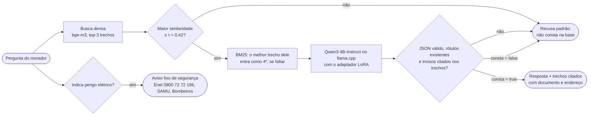

# Luz Segura: assistente de iluminação pública

Componente de inteligência do MVP **Luz Segura** (FIAP Global Solution 2026.2, CitizenTech, Engenharia de Software 4ES), disciplina **Generative AI for Engineering**.

O Luz Segura ajuda quem anda a pé ou usa transporte público à noite em Osasco (SP) a relatar pontos escuros e a cobrar o conserto da iluminação pública. Este repositório tem o **assistente** do serviço, um modelo de linguagem local que tira dúvidas do morador sobre iluminação pública. Ele responde em português simples, devolve sempre um JSON, cita os trechos da base de conhecimento em que se apoia e diz **"não consta"** quando a base não cobre a pergunta. Exemplos de dúvidas: quem conserta a lâmpada da rua, como pedir, o que é a CIP na conta de luz, o que fazer com um fio caído e como funciona o próprio Luz Segura.

O mesmo modelo local foi avaliado em três configurações (sem contexto, RAG simples e RAG + LoRA) com o mesmo conjunto de teste. O relatório da entrega está em [RELATORIO.md](RELATORIO.md).

## Integrantes

| Nome completo | RM |
|---|---|
| Arthur Bessa Pian | RM99215 |
| Davi Almeida Desenzi | RM550849 |
| Fabrício Gutierrez Saavedra | RM97631 |
| João Victor Soares | RM551410 |
| Márcio Gastaldi de Oliveira Soares | RM98811 |

## Link

- **Vídeo:** [VIDEO PITCH](https://youtu.be/fCVAo9lV0XQ)

## Ficha técnica do MVP

| campo | Luz Segura |
|---|---|
| Nome do produto | Luz Segura |
| Cidadão e território | quem anda a pé ou usa transporte público à noite em Osasco (SP) |
| Problema, em uma frase | ruas e paradas de ônibus mal iluminadas deixam o trajeto noturno inseguro, e o morador não sabe a quem pedir o conserto (Prefeitura ou Enel) nem como cobrar |
| Proposta de valor | relatar um ponto escuro com foto e localização, receber um texto pronto para o pedido oficial na Central 156 e tirar dúvidas com respostas que citam a fonte |
| Arquitetura: componentes | relato com foto e localização; visão computacional que classifica a iluminação da foto; lista de prioridades que junta relatos repetidos e cruza o ponto com paradas de ônibus e previsão do tempo; robô de verificação com sensor de luminosidade; mapa agregado de pontos escuros; e o assistente deste repositório (busca, modelo local e API) |
| Fontes de dados | do assistente: 26 documentos em 76 trechos ([base/fontes.md](base/fontes.md)); do produto: relatos e fotos dos moradores, paradas de ônibus e previsão do tempo |
| Modelos de IA utilizados | do assistente: Qwen3-4B-Instruct-2507 com adaptador LoRA próprio, e BAAI/bge-m3 na busca; do produto: modelo de visão computacional que classifica a foto |
| URL do MVP e repositório | repositório deste componente: https://github.com/Gastaldl/GS-GENAI |
| Indicadores de impacto (assistente) | parcela das perguntas respondidas com fonte e parcela recusada, por motivo, tiradas do registro mascarado; perguntas recusadas que viram trechos novos na base; tempo de resposta; placar líquido no conjunto de teste a cada mudança da base |
| ODS conectados | ODS 11 (metas 11.2 e 11.7), ODS 10 (meta 10.2) e ODS 9 (meta 9.1); a contribuição para cada meta está no [RELATORIO.md](RELATORIO.md), seção 2.1 |

## Resultados

Placar no conjunto de teste, com o mesmo modelo local nas três configurações. São 60 casos: 39 que a base responde e 21 que não constam nela. O placar líquido dá +1 por acerto ou recusa correta, −1 por alucinação ou resposta indevida e 0 no resto, e divide pelo número de casos. Os detalhes estão no [notebook 04](notebooks/04_placar_e_erros.ipynb) e no [RELATORIO.md](RELATORIO.md).

| configuração | placar líquido | acerto (IC 95%) | corretas (de 39) | recusas corretas (de 21) | resposta sem apoio entre as dadas | segundos por pergunta |
|---|---|---|---|---|---|---|
| sempre recusa (referência) | 0,350 | 35,0% (24,2 a 47,6) | 0 | 21 | – | – |
| 1. sem contexto | 0,183 | 33,3% (22,7 a 45,9) | 1 | 19 | 9 de 12 | 0,68 |
| 2. RAG simples | 0,783 | 81,7% (70,1 a 89,4) | 30 | 19 | 2 de 32 | 2,16 |
| 3. RAG + LoRA | 0,800 | 85,0% (73,9 a 91,9) | 31 | 20 | 3 de 35 | 2,42 |

- **A busca é o que faz o assistente funcionar.** Sem contexto, o modelo recusa quase tudo e, quando responde, inventa: são 7 alucinações. Com os trechos, o placar vai de 0,183 para 0,783 (McNemar, p < 0,001).
- **O LoRA troca um erro por outro.** Ele reduz as recusas indevidas de 9 para 5, mas passa a inventar detalhes no estilo das respostas de treino, como um inciso de lei que não existe. A diferença para o RAG simples não é significativa: 5 casos a favor e 3 contra, p = 0,73.
- **O sistema final foi escolhido só no dev.** É a RAG + LoRA, com a busca que acrescenta um 4º trecho do BM25 e a conferência dos incisos citados. No teste, só como conferência, marca 0,850, com acerto de 88,3%. Esse número é otimista: as duas correções partiram de erros vistos no teste (t08 e t32 no erro 3, t09 no erro 5). A comparação das configurações fica com o placar da tabela.
- **O juiz automático foi auditado antes do placar final.** A auditoria foi cega e corrigiu 15 julgamentos em 11 casos, sempre com a mesma regra para todas as configurações (notebook 04, seção 4).

## Ficha técnica do componente de IA

| item | escolha |
|---|---|
| Tarefa | perguntas e respostas fundamentadas sobre iluminação pública em Osasco e sobre o Luz Segura, com citação da fonte e recusa ("não consta") |
| Modelo | [Qwen/Qwen3-4B-Instruct-2507](https://huggingface.co/Qwen/Qwen3-4B-Instruct-2507) (4 bilhões de parâmetros, Apache-2.0), em GGUF Q8_0 ([unsloth/Qwen3-4B-Instruct-2507-GGUF](https://huggingface.co/unsloth/Qwen3-4B-Instruct-2507-GGUF), sha256 `391c1e41…ef068`) |
| Execução | local, com [llama.cpp](https://github.com/ggml-org/llama.cpp) `llama-server` versão b12359 (Vulkan) numa GPU AMD Radeon RX 6750 XT (12 GB); temperatura 0, semente 42, até 400 tokens, cache de prompt desligado |
| Busca | densa, com [BAAI/bge-m3](https://huggingface.co/BAAI/bge-m3) (MIT) em CPU, similaridade de cosseno, k = 3 trechos, limiar τ = 0,42; no sistema final, o melhor trecho da busca léxica BM25 (radicais de 5 letras) entra como 4º trecho quando ainda não está entre os 3 (escolha no dev, notebook 04) |
| Base de conhecimento | 26 documentos e 76 trechos de até 250 palavras: 7 atos oficiais, 3 páginas gov.br, 1 publicação do Banco Mundial, 9 fichas em redação própria e 6 documentos do produto ([base/LEIAME.md](base/LEIAME.md)) |
| Partição | trechos sorteados (semente 2026) em treino 35, dev 16 e teste 25, estratificados por documento |
| Avaliação | 60 casos de teste (39 com resposta, 21 que não constam) e 40 de dev (24 e 16), com gabarito, pontos-chave, padrões proibidos e evidência literal |
| Ajuste fino | LoRA rank 16 com QLoRA 4 bits no Google Colab (T4), 328 exemplos de treino e 37 de validação, só com trechos de treino ([treino/LEIAME.md](treino/LEIAME.md)); adaptador convertido para GGUF f16 (66 MB), da época 2, escolhida no dev |
| Saída | JSON `{"consta", "resposta", "fontes"}` do modelo, validado; a API devolve os trechos citados (documento, endereço e texto), um aviso fixo de segurança em caso de perigo elétrico e um diagnóstico |
| Proteção de dados (LGPD) | o modelo roda localmente; o CPF é mascarado antes da busca e do modelo; o registro guarda só a pergunta mascarada (CPF, telefone e e-mail), os identificadores dos trechos recuperados, a indicação de recusa com o motivo e o tempo de resposta, num arquivo por dia apagado depois de 30 dias |

## Pipeline



O diagrama mostra o sistema final, o que a API usa, escolhido no dev pelo notebook 04 (`avaliacao/sistema_final.json`). No placar, as configurações 2 e 3 usam só a busca densa, e nenhuma das três confere os incisos:
- a **sem contexto** manda só a pergunta ao modelo, sem busca e sem limiar;
- a **RAG simples** segue o fluxo com o adaptador desligado;
- a **RAG + LoRA** liga o adaptador na mesma requisição, porque o `llama-server` carrega o adaptador uma vez e cada pedido escolhe a escala (0 ou 1).

## Estrutura do repositório

```
base/            base de conhecimento: documentos, trechos (trechos.jsonl) e fontes com licenças
avaliacao/       casos de teste e dev (com a justificativa de cada caso sem resposta), partição dos trechos, limiar,
                 saídas brutas de cada execução (saidas/), placar e sistema final escolhido no dev
treino/          dados de treino do LoRA e scripts de montagem, conversão do adaptador e limpeza do notebook do Colab
notebooks/       01 base e busca · 02 geração (sem contexto e RAG) · 03 treino LoRA (Colab) · 04 placar e erros
src/luz_segura/  biblioteca: base, partição, busca, prompt, cliente do llama.cpp, validação, assistente, avaliação, privacidade e segurança
api/             API (FastAPI) e página de conversa
modelos/         adaptador LoRA treinado (o modelo base é baixado; veja modelos/LEIAME.md)
tests/           testes automatizados (pytest)
```

## Como reproduzir

Os passos abaixo foram executados no Windows 11 com Python 3.12. Em Linux ou macOS, troque o binário do llama.cpp pelo da sua plataforma (variável `LUZ_LLAMA_SERVER`).

**1. Repositório e ambiente Python.** Com [uv](https://docs.astral.sh/uv/):

```
git clone https://github.com/Gastaldl/GS-GENAI.git
cd GS-GENAI
uv sync
```

Ou, com pip: `pip install -r requirements.txt pytest` e depois `pip install -e .`. Sem o uv, rode os comandos abaixo sem o prefixo `uv run` (por exemplo, `python -m pytest`). O PyTorch vem do índice de CPU, porque a busca roda em CPU.

**2. Modelo base e llama.cpp.**

```
uv run hf download unsloth/Qwen3-4B-Instruct-2507-GGUF Qwen3-4B-Instruct-2507-Q8_0.gguf --revision a06e946bb6b655725eafa393f4a9745d460374c9 --local-dir modelos/base
uv run hf download Qwen/Qwen3-4B-Instruct-2507 config.json tokenizer_config.json --revision cdbee75f17c01a7cc42f958dc650907174af0554 --local-dir modelos/base/hf-config
```

O arquivo GGUF tem 4.280.405.600 bytes e sha256 `391c1e410fd9f4cf2de2b510273b56a84c19ce18f4fa3bfb3774031dac4ef068`. Para conferir: `Get-FileHash modelos/base/Qwen3-4B-Instruct-2507-Q8_0.gguf -Algorithm SHA256` no PowerShell ou `sha256sum modelos/base/Qwen3-4B-Instruct-2507-Q8_0.gguf` no Linux. O llama.cpp é a versão [b12359](https://github.com/ggml-org/llama.cpp/releases/tag/b12359). No Windows, o pacote `llama-b12359-bin-win-vulkan-x64.zip` deve ser extraído em `ferramentas/llama-b12359-vulkan/`. Os detalhes estão em [modelos/LEIAME.md](modelos/LEIAME.md).

Os modelos de embeddings (bge-m3, que tem cerca de 2,3 GB, e os dois comparados no notebook 01) são baixados do Hugging Face no primeiro uso, sempre no commit fixado em `src/luz_segura/retrieval.py`.

**3. Base, partição e casos.** Os arquivos gerados já estão no repositório. Para gerar de novo:

```
uv run python -m luz_segura.knowledge_base
uv run python -m luz_segura.split
uv run python avaliacao/build_cases.py
```

**4. Notebooks, em ordem.** O notebook 02 sobe o `llama-server` sozinho na porta 8080 se ele não estiver rodando. O notebook 04 sobe o seu próprio servidor na porta 8081, uma vez para cada adaptador: as épocas do treino, se estiverem em `modelos/epocas/`, e o escolhido.

```
uv run jupyter nbconvert --to notebook --execute --inplace notebooks/01_base_e_busca.ipynb
uv run jupyter nbconvert --to notebook --execute --inplace notebooks/02_geracao_rag.ipynb
uv run jupyter nbconvert --to notebook --execute --inplace notebooks/04_placar_e_erros.ipynb
```

As saídas brutas do modelo ficam em `avaliacao/saidas/`, com uma impressão digital de tudo o que muda a saída do modelo: modelo, versão do llama.cpp, parâmetros de geração, formato das mensagens, texto dos trechos, perguntas, busca e adaptador. O gabarito dos casos fica de fora, porque só é lido na classificação. Ao reexecutar, os notebooks reaproveitam as saídas se nada mudou. Para gerar as saídas de novo, apague os arquivos de `avaliacao/saidas/`, menos `dev_rag_lora_epoca1.jsonl`, `dev_rag_lora_epoca2.jsonl` e `dev_rag_lora_epoca3.jsonl`. Os GGUF das épocas ficam fora do repositório, e sem eles o notebook 04 escolhe a época por essas três saídas. Para refazer também a escolha da época, gere as épocas pelo passo 5. Com temperatura 0, semente fixa e cache de prompt desligado, o mesmo modelo, na mesma versão do llama.cpp e na mesma GPU, gera as mesmas saídas.

**5. Treino do LoRA (opcional; o adaptador treinado já está em `modelos/adaptador/`).**

1. `uv run python treino/build_training_data.py` gera `treino/treino.jsonl` e `treino/validacao.jsonl`.
2. Abra `notebooks/03_treino_lora_colab.ipynb` no Google Colab com GPU T4, rode tudo e envie os dois arquivos quando o notebook pedir. Ele devolve `adaptador_luz_segura.zip`, com o adaptador de cada época (cerca de 200 MB: deixe o zip fora do repositório, por exemplo na pasta Downloads). Baixe também o notebook executado, salve-o em `notebooks/03_treino_lora_colab.ipynb` e tire os metadados da conta Google com `uv run python treino/clean_colab_notebook.py notebooks/03_treino_lora_colab.ipynb`.
3. Prepare as ferramentas de conversão (uma vez):

   ```
   git clone --depth 1 --branch b12359 https://github.com/ggml-org/llama.cpp ferramentas/llama-b12359-fonte
   uv venv --python 3.12 ferramentas/venv-conversao
   uv pip install --python ferramentas/venv-conversao -r ferramentas/llama-b12359-fonte/requirements/requirements-convert_lora_to_gguf.txt
   ```

4. Converta as épocas para GGUF com `uv run python treino/convert_adapter.py <caminho do zip>`. O script extrai o zip em `modelos/treino_lora/`, grava `modelos/epocas/epoca_<n>.gguf` para cada época e copia as métricas do treino (`metricas_treino.json`) e o exemplo formatado (`exemplo_formatado.txt`) para `modelos/adaptador/`. Para usar outras pastas, `LUZ_LLAMA_SOURCE` aponta para o código-fonte do llama.cpp e `LUZ_CONVERSION_PYTHON` para o executável Python do ambiente de conversão (`ferramentas/venv-conversao/Scripts/python.exe` no Windows, `ferramentas/venv-conversao/bin/python` no Linux e no macOS).
5. O notebook 04 escolhe a época no dev e copia a escolhida para `modelos/adaptador/luz-segura-lora-f16.gguf`.

**6. API.**

```
ferramentas/llama-b12359-vulkan/llama-server -m modelos/base/Qwen3-4B-Instruct-2507-Q8_0.gguf --lora modelos/adaptador/luz-segura-lora-f16.gguf --lora-init-without-apply --host 127.0.0.1 --port 8080 -c 8192 -np 1 -ngl 99
uv run uvicorn api.app:app --port 8000
```

Abra http://127.0.0.1:8000 para usar a página de conversa, ou chame a API diretamente:

```
POST /perguntar   {"pergunta": "A lâmpada da minha rua está apagada. Quem conserta?", "configuracao": "rag_lora"}
GET  /saude
```

A `configuracao` é opcional. Os valores possíveis são `rag_lora`, `rag` e `no_context`. Sem valor, a API usa a configuração escolhida no dev pelo notebook 04 (`avaliacao/sistema_final.json`), ou `rag` se o servidor não tiver o adaptador. A busca e a conferência dos incisos citados também vêm desse arquivo; `GET /saude` mostra a busca em uso e se os incisos são conferidos (`confere_incisos`). Nas configurações com trechos (`rag` e `rag_lora`), uma resposta que cita um inciso ausente dos trechos vira a recusa padrão, com `motivo_recusa` igual a `dispositivo_sem_apoio`. A `no_context` não recebe trechos e não passa por essa conferência. Se o `llama-server` estiver fora do ar, a API responde 503.

Variáveis de ambiente (todas opcionais):

| variável | uso | padrão |
|---|---|---|
| `LUZ_SERVER_URL` | endereço do `llama-server` | `http://127.0.0.1:8080` |
| `LUZ_LLAMA_SERVER` | executável do `llama-server` que os notebooks sobem | `ferramentas/llama-b12359-vulkan/llama-server.exe` |
| `LUZ_DEFAULT_MODE` | configuração padrão da API (`rag_lora`, `rag` ou `no_context`) | a de `avaliacao/sistema_final.json` |
| `LUZ_LOG_DIR` | pasta dos registros mascarados | `registros/` |

**7. Testes.**

```
uv run pytest
```

Os testes cobrem:

- a base e a partição (reprodutíveis);
- os casos (evidência literal e justificativa de cada caso sem resposta);
- a validação do JSON e a conferência dos incisos citados;
- a classificação das respostas, inclusive a regra de negação dos padrões proibidos e os dados sem apoio;
- a impressão digital das execuções salvas;
- a busca corrigida;
- a privacidade e o aviso de segurança;
- os dados de treino (só trechos de treino e nenhuma pergunta de avaliação);
- a limpeza do notebook do Colab;
- a API, com modelo e busca simulados.

## Licenças

O modelo Qwen3-4B-Instruct-2507 é Apache-2.0, o bge-m3 é MIT e o llama.cpp é MIT. A licença de cada documento da base está em [base/fontes.md](base/fontes.md). Atos oficiais e páginas gov.br (CC BY-ND 3.0) entram como texto literal. O Guia de PPP de Iluminação Pública do Banco Mundial (todos os direitos reservados) entra como trecho curto e literal, com a fonte, porque o guia permite reproduzir partes citando a fonte. Páginas sem licença aberta entram só como fatos contados com palavras próprias, com endereço e data de acesso.
