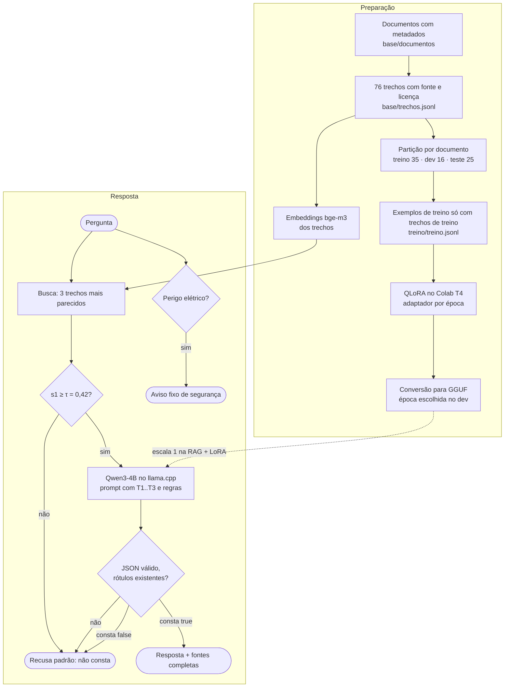

# Relatório · Luz Segura, assistente de iluminação pública

FIAP Global Solution 2026.2 · CitizenTech · Engenharia de Software 4ES · Generative AI for Engineering

## 1. Integrantes

| Nome completo | RM |
|---|---|
| Arthur Bessa Pian | RM99215 |
| Davi Almeida Desenzi | RM550849 |
| Fabrício Gutierrez Saavedra | RM97631 |
| João Victor Soares | RM551410 |
| Márcio Gastaldi de Oliveira Soares | RM98811 |

## 2. Ficha técnica

| item | escolha |
|---|---|
| Problema | o morador de Osasco não sabe a quem recorrer quando a iluminação da rua falha (Prefeitura ou Enel, Central 156, ouvidoria, emergência), nem o que é a CIP na conta de luz, e o Luz Segura precisa explicar o próprio funcionamento sem inventar regras |
| Tarefa do modelo | responder em português simples só com base nos trechos recuperados, devolver JSON com a citação dos trechos usados e recusar ("não consta") quando os trechos não trazem a informação |
| Modelo | Qwen/Qwen3-4B-Instruct-2507 (4 bilhões de parâmetros, Apache-2.0), sem modo de raciocínio, em GGUF Q8_0 (unsloth, sha256 `391c1e410fd9f4cf2de2b510273b56a84c19ce18f4fa3bfb3774031dac4ef068`) |
| Execução | local, com llama.cpp `llama-server` b12359 (Vulkan) numa GPU AMD Radeon RX 6750 XT de 12 GB; temperatura 0, semente 42, até 400 tokens, cache de prompt desligado; o adaptador fica carregado e cada requisição escolhe a escala (0 ou 1) |
| Busca | densa, com BAAI/bge-m3 (MIT) em CPU; texto indexado "documento > seção + texto"; cosseno; k = 3; limiar τ = 0,42 na maior similaridade |
| Base | 26 documentos e 76 trechos de até 250 palavras (mediana de 83): 7 atos oficiais, 3 páginas gov.br, 1 publicação do Banco Mundial, 9 fichas em redação própria e 6 documentos do produto |
| Partição | trechos sorteados por documento (semente 2026, proporções-alvo 50/20/30%): treino 35, dev 16 e teste 25; cada pergunta respondível herda a partição do seu trecho principal (o primeiro de evidência), e as perguntas sem resposta foram escritas à parte para dev e para teste |
| Avaliação | 60 casos de teste (39 com resposta, 21 que não constam) e 40 de dev (24 e 16), em 10 categorias: fato direto, paráfrase, procedimento, risco elétrico, dois trechos, parcial, pergunta adversarial com resposta, perto do tema sem resposta, fora do tema e manipulação |
| Métricas | recall@1 e recall@3 da busca; JSON estrito; desfecho por caso (correta, insuficiente, alucinação, recusa disfarçada, recusa indevida, recusa correta, resposta indevida); placar líquido (+1/0/−1); taxa de resposta; resposta sem apoio entre respondidas ((alucinação + resposta indevida) / respostas dadas); citação de trecho de evidência; intervalos de Wilson; teste de McNemar |
| Ajuste fino | LoRA rank 16, alpha 16, dropout 0,05 nas 7 projeções, QLoRA 4 bits (nf4), 3 épocas, taxa 2e-4 cosseno, lote efetivo 8, perda só na resposta; 328 exemplos de treino e 37 de validação montados só com trechos de treino; Google Colab com GPU T4; época escolhida no dev; adaptador convertido para GGUF f16 <!-- TAMANHO_ADAPTADOR --> |
| Saída da API | `consta`, `resposta`, `fontes` (id, documento, endereço e texto de cada trecho citado), `aviso_seguranca` (fixo, com fonte, quando a pergunta indica perigo elétrico) e `diagnostico` (modelo, similaridade máxima, limiar e motivo da recusa) |
| Proteção de dados | o modelo e a busca rodam na máquina local; o registro guarda só a pergunta mascarada (CPF, telefone e e-mail), os identificadores dos trechos usados, a indicação de recusa com o motivo e o tempo de resposta, como diz a política de privacidade da base; um arquivo por dia, apagado depois de 30 dias (a limpeza roda quando a API sobe e a cada registro) |

## 3. Pipeline

1. **Base.** Cada documento tem cabeçalho com fonte, órgão, endereço, formato original, tipo, licença e data de acesso. Cada seção vira um trecho.
2. **Busca.** A pergunta e os trechos viram vetores bge-m3. Os 3 trechos de maior cosseno entram no prompt com os rótulos T1 a T3. Se a maior similaridade fica abaixo de τ = 0,42, o sistema recusa sem chamar o modelo.
3. **Geração.** O modelo devolve `{"consta", "resposta", "fontes"}`. O código valida o JSON e os rótulos, troca cada rótulo pelo trecho real (documento, endereço e texto) e transforma qualquer saída inválida na recusa padrão.
4. **Segurança.** Uma regra por palavras-chave detecta perigo elétrico imediato (fio caído, choque, poste caindo) e acrescenta um aviso fixo com os telefones de emergência e as fontes, seja qual for a resposta do modelo.
5. **Três configurações do mesmo modelo.** Na **sem contexto**, só a pergunta vai ao modelo. Na **RAG simples**, entram os trechos com o adaptador desligado. Na **RAG + LoRA**, os mesmos trechos com o adaptador ligado.

## 4. Base de conhecimento

Acesso a todas as fontes em 15/11/2026. Atos oficiais e páginas gov.br (CC BY-ND 3.0) entram como texto literal. O guia do Banco Mundial entra como trecho curto, com a fonte. Páginas sem licença aberta (Osasco Digital, Central 156, Enel, ABNT) entram só como fatos contados com palavras próprias, com endereço e data de acesso. Os documentos do produto descrevem o próprio Luz Segura. Detalhes em [base/LEIAME.md](base/LEIAME.md).

| documento | fonte | formato original | licença | trechos |
|---|---|---|---|---|
| `aneel-distribuidoras` | [ANEEL, Fale com a sua distribuidora](https://www.gov.br/aneel/pt-br/canais_atendimento/fale-com-a-sua-distribuidora); Agência Nacional de Energia Elétrica (ANEEL), portal gov.br | HTML | CC BY-ND 3.0 (texto literal, com crédito) | 1 |
| `aneel-iluminacao` | [ANEEL, página Iluminação Pública](https://www.gov.br/aneel/pt-br/assuntos/iluminacao-publica); Agência Nacional de Energia Elétrica (ANEEL), portal gov.br | HTML | CC BY-ND 3.0 (texto literal, com crédito) | 1 |
| `cf88` | [Constituição Federal](https://www.planalto.gov.br/ccivil_03/constituicao/constituicao.htm); Presidência da República (portal da legislação do Planalto) | HTML (texto compilado) | ato oficial, sem proteção de direito autoral (Lei 9.610/1998, art. 8º, IV) | 2 |
| `cidades-vendaval` | [Defesa Civil Nacional, orientações para vendaval](https://www.gov.br/cidades/pt-br/noticias/anterior/saiba-como-proceder-em-casos-de-vendaval); Ministério das Cidades, portal gov.br | HTML | CC BY-ND 3.0 (texto literal, com crédito) | 1 |
| `decreto14955-ufmo` | [Decreto 14.955/2025 de Osasco (UFMO 2026)](https://osasco.sp.gov.br/wp-content/uploads/2025/12/iomo-2938.pdf); Prefeitura de Osasco, Imprensa Oficial do Município (IOMO nº 2938, de 12/12/2025, pág. 1) | PDF (diário oficial com texto extraível) | ato oficial, sem proteção de direito autoral (Lei 9.610/1998, art. 8º, IV) | 1 |
| `ficha-cip` | [Ficha, CIP na conta de luz](https://osasco.sp.gov.br/wp-content/uploads/2022/12/iomo-2365.pdf); redação própria a partir da Constituição Federal (art. 149-A), da LC 404/2022 e da LC 447/2025 de Osasco, do Decreto 14.955/2025 e da página da ANEEL sobre iluminação pública | PDF do diário oficial e HTML | texto do projeto | 3 |
| `ficha-distribuidora` | [Ficha, distribuidora de energia em Osasco](https://www.gov.br/aneel/pt-br/canais_atendimento/fale-com-a-sua-distribuidora); redação própria a partir de páginas da ANEEL, da ARSESP e da Enel Distribuição São Paulo | HTML e PDF | texto do projeto; a fonte não tem licença aberta, então só fatos com palavras próprias | 4 |
| `ficha-normas-tecnicas` | [Ficha, normas técnicas de iluminação](https://www.abntcatalogo.com.br/pnm.aspx?Q=Z01ZUmVrdk5Rc0ZnZndvQUtFQUphU3RJcmJzUm1pdkl6bHc1MTAwQzBPRT0=); redação própria a partir do Catálogo ABNT e do Diário Oficial da União (Portaria Inmetro 62/2022) | HTML | texto do projeto; a fonte não tem licença aberta, então só fatos com palavras próprias | 2 |
| `ficha-ouvidoria` | [Ficha, reclamação na Ouvidoria](https://osascodigital.osasco.sp.gov.br/servicos/9738); redação própria a partir da Carta de Serviços (Manifestações de Serviço Público Municipal), da página da Ouvidoria Geral de Osasco e da Lei 13.460/2017 | Página HTML que exige JavaScript (Carta de Serviços) e HTML estático (portal da Prefeitura) | texto do projeto; a fonte não tem licença aberta, então só fatos com palavras próprias | 3 |
| `ficha-pedido-156` | [Ficha, pedido de conserto na Central 156](https://osascodigital.osasco.sp.gov.br/servicos/14807); redação própria a partir da Carta de Serviços de Osasco, do portal Central 156 e da página de iluminação pública da Enel São Paulo | Páginas HTML que exigem JavaScript (Carta de Serviços e Central 156) e HTML estático (Enel e portal da Prefeitura) | texto do projeto; a fonte não tem licença aberta, então só fatos com palavras próprias | 8 |
| `ficha-poda` | [Ficha, poda de árvore que encobre a luz](https://osascodigital.osasco.sp.gov.br/servicos/9739); redação própria a partir da Carta de Serviços de Osasco (Manutenção Arbórea), da Lei municipal 3.995/2005 e de orientações da Enel São Paulo | Página HTML que exige JavaScript e PDF do diário oficial | texto do projeto; a fonte não tem licença aberta, então só fatos com palavras próprias | 2 |
| `ficha-prazos` | [Ficha, prazos de atendimento](https://central156.osasco.sp.gov.br/servicos); redação própria a partir do portal Central 156, da Carta de Serviços de Osasco e da Lei 13.460/2017 | Páginas HTML que exigem JavaScript | texto do projeto; a fonte não tem licença aberta, então só fatos com palavras próprias | 2 |
| `ficha-responsaveis` | [Ficha, quem é quem na iluminação pública](https://www.gov.br/aneel/pt-br/assuntos/iluminacao-publica); redação própria a partir da REN ANEEL 1.000/2021, da página da ANEEL sobre iluminação pública, das LCs 403/2022, 448/2025 e 464/2026 de Osasco e do Decreto 14.078/2024 | HTML e PDF do diário oficial | texto do projeto | 3 |
| `ficha-risco-eletrico` | [Ficha, risco elétrico e telefones de emergência](https://www.enel.com.br/pt-saopaulo/midia/news/d2026-2/fios-caidos-apos-tempestades-como-agir-com-seguranca.html); redação própria a partir de páginas da Enel Distribuição São Paulo, da ANEEL, da Prefeitura de Osasco (Defesa Civil e Guarda Civil Municipal) e da Anatel | HTML | texto do projeto; a fonte não tem licença aberta, então só fatos com palavras próprias | 4 |
| `guia-ppp` | [Guia de PPP de Iluminação Pública (2022)](https://www.gov.br/casacivil/pt-br/ocultadas/orgaos/seppi/centrais-de-conteudo/publicacoes-institucionais/guia.pdf); Banco Internacional para Reconstrução e Desenvolvimento/Banco Mundial, publicado no portal da Casa Civil (SEPPI) | PDF (299 páginas) | reprodução parcial permitida com citação da fonte | 1 |
| `lc404-cip` | [LC 404/2022 de Osasco (CIP)](https://osasco.sp.gov.br/wp-content/uploads/2022/12/iomo-2365.pdf); Prefeitura de Osasco, Imprensa Oficial do Município (IOMO nº 2365, de 29/12/2022, págs. 2563 a 2567, 2625 a 2626 e 2671; art. 216 na redação da LC 447/2025, IOMO nº 2865, de 04/07/2025, pág. 2) | PDF (diário oficial com texto extraível) | ato oficial, sem proteção de direito autoral (Lei 9.610/1998, art. 8º, IV) | 7 |
| `lc448-delegacao` | [LC 448/2025 de Osasco (delegação da iluminação pública)](https://osasco.sp.gov.br/wp-content/uploads/2025/07/iomo-2865.pdf); Prefeitura de Osasco, Imprensa Oficial do Município (IOMO nº 2865, de 04/07/2025, págs. 3 e 4) | PDF (diário oficial com texto extraível) | ato oficial, sem proteção de direito autoral (Lei 9.610/1998, art. 8º, IV) | 1 |
| `lc464-estrutura` | [LC 464/2026 de Osasco (estrutura da Prefeitura)](https://osasco.sp.gov.br/wp-content/uploads/2026/10/iomo-3109.pdf); Prefeitura de Osasco, Imprensa Oficial do Município (IOMO nº 3109, de 22/10/2026, págs. 41, 42 e 872) | PDF (diário oficial com texto extraível) | ato oficial, sem proteção de direito autoral (Lei 9.610/1998, art. 8º, IV) | 2 |
| `lei13460` | [Lei 13.460/2017](https://www.planalto.gov.br/ccivil_03/_ato2015-2018/2017/lei/l13460.htm); Presidência da República (portal da legislação do Planalto) | HTML (texto compilado) | ato oficial, sem proteção de direito autoral (Lei 9.610/1998, art. 8º, IV) | 4 |
| `produto-assistente` | [Luz Segura, como o assistente responde](base/documentos/produto-assistente.md); Projeto Luz Segura (FIAP Global Solution 2026.2) | Markdown | texto do projeto | 2 |
| `produto-foto` | [Luz Segura, tratamento da foto](base/documentos/produto-foto.md); Projeto Luz Segura (FIAP Global Solution 2026.2) | Markdown | texto do projeto | 3 |
| `produto-prioridade` | [Luz Segura, critérios de prioridade](base/documentos/produto-prioridade.md); Projeto Luz Segura (FIAP Global Solution 2026.2) | Markdown | texto do projeto | 3 |
| `produto-privacidade` | [Luz Segura, política de privacidade](base/documentos/produto-privacidade.md); Projeto Luz Segura (FIAP Global Solution 2026.2) | Markdown | texto do projeto | 3 |
| `produto-relato` | [Luz Segura, como relatar um ponto escuro](base/documentos/produto-relato.md); Projeto Luz Segura (FIAP Global Solution 2026.2) | Markdown | texto do projeto | 3 |
| `produto-sobre` | [Luz Segura, sobre o serviço](base/documentos/produto-sobre.md); Projeto Luz Segura (FIAP Global Solution 2026.2) | Markdown | texto do projeto | 3 |
| `ren1000` | [REN ANEEL 1.000/2021](https://leis.org/institucionais/br/aneel/lei/resolucao-normativa/2021/1000/resolucao-normativa-n-1000-2021-estabelece-as-regras-de-prestacao-do-servico-publico-de-distribuicao-de-energia-eletrica-revoga-as-resolucoes-normativas-aneel-no-414-de-9-de-setembro-de-2010-no-470-de-13-de-dezembro-de-2011-no-901-de-8-de-dezembro-de-2020-e-da-outras-providencias); Agência Nacional de Energia Elétrica (ANEEL), texto compilado na plataforma de legislação indicada pela agência | HTML (texto compilado com alterações até a REN 1.174/2026) | ato oficial, sem proteção de direito autoral (Lei 9.610/1998, art. 8º, IV) | 7 |
| **total** | 26 documentos | | | **76** |

<!-- SECOES_FINAIS -->
