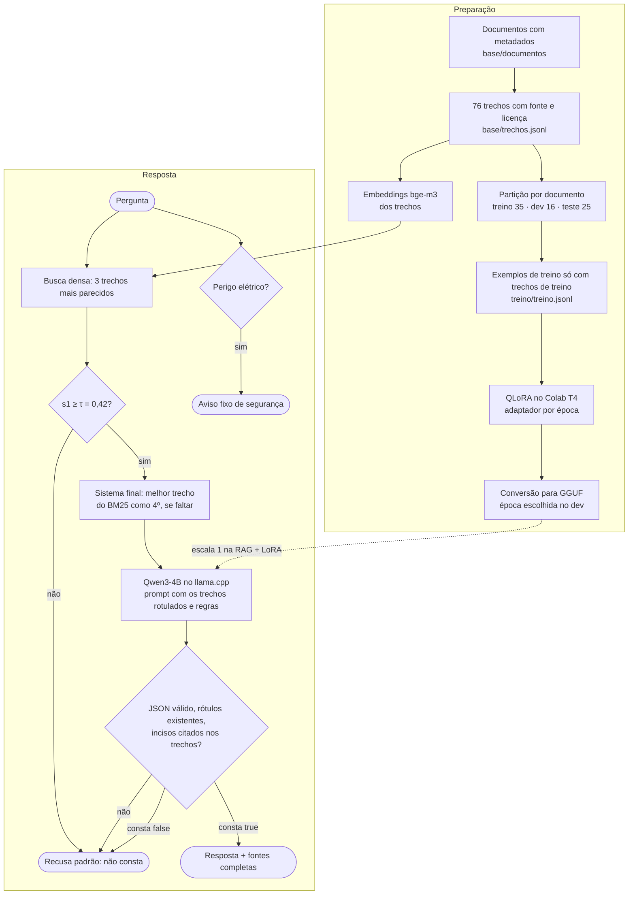

# Relatório · Luz Segura, assistente de iluminação pública

FIAP Global Solution 2026.2 · CitizenTech · Engenharia de Software 4ES · Generative AI for Engineering

## 1. Integrantes

| Nome completo | RM |
|---|---|
| Arthur Bessa Pian | RM99215 |
| Davi Almeida Desenzi | RM550849 |
| Fabrício Gutierrez Saavedra | RM97631 |
| João Victor Soares | RM551410 |
| Márcio Gastaldi de Oliveira Soares | RM98811 |

## 2. Ficha técnica

### 2.1 Ficha técnica do MVP

| campo | Luz Segura |
|---|---|
| Nome do produto | Luz Segura |
| Cidadão e território | quem anda a pé ou usa transporte público à noite em Osasco (SP) |
| Problema, em uma frase | ruas e paradas de ônibus mal iluminadas deixam o trajeto noturno inseguro, e o morador não sabe a quem pedir o conserto (Prefeitura ou Enel) nem como cobrar |
| Proposta de valor | relatar um ponto escuro com foto e localização, receber um texto pronto para o pedido oficial na Central 156 e tirar dúvidas com respostas que citam a fonte |
| Arquitetura: componentes | relato com foto e localização; visão computacional que classifica a iluminação da foto; lista de prioridades que junta relatos repetidos e cruza o ponto com paradas de ônibus e previsão do tempo; robô de verificação com sensor de luminosidade; mapa agregado de pontos escuros; e o assistente deste repositório (busca, modelo local e API) |
| Fontes de dados | do assistente: 26 documentos em 76 trechos (atos oficiais, páginas gov.br, Banco Mundial, fichas em redação própria e documentos do produto, seção 4); do produto: relatos e fotos dos moradores, paradas de ônibus e previsão do tempo |
| Modelos de IA utilizados | do assistente: Qwen3-4B-Instruct-2507 com adaptador LoRA próprio, e BAAI/bge-m3 na busca; do produto: modelo de visão computacional que classifica a foto |
| URL do MVP e repositório | repositório deste componente: https://github.com/Gastaldl/GS-GENAI |
| Indicadores de impacto (assistente) | parcela das perguntas respondidas com fonte e parcela recusada, por motivo (limiar, modelo, validação, inciso sem apoio), tiradas do registro mascarado; perguntas recusadas que viram trechos novos na base depois da revisão; tempo de resposta; e, a cada mudança da base, placar líquido e resposta sem apoio no conjunto de teste (hoje 0,800 e 8,6% na configuração 3) |
| ODS conectados | ODS 11 (metas 11.2 e 11.7), ODS 10 (meta 10.2) e ODS 9 (meta 9.1) |

Como o produto contribui para cada ODS:
- **ODS 11, metas 11.7 e 11.2.** A meta 11.7 pede espaços públicos seguros, inclusivos e acessíveis, em especial para mulheres, crianças, idosos e pessoas com deficiência. A 11.2 pede transporte seguro e acessível. O Luz Segura leva o ponto escuro da calçada e da parada de ônibus até o pedido de conserto, e o assistente explica a quem pedir e como.
- **ODS 10, meta 10.2.** A meta pede a inclusão de todos. O assistente responde de graça, em português simples e sem pedir identificação. Ele roda numa placa de vídeo comum, sem serviço pago de terceiros.
- **ODS 9, meta 9.1.** A meta pede infraestrutura de qualidade e confiável, com acesso equitativo. O pedido que chega ao responsável certo (Prefeitura ou Enel), com o texto pronto, apoia a manutenção da iluminação pública.

### 2.2 Ficha técnica do componente de IA

| item | escolha |
|---|---|
| Problema | o morador de Osasco não sabe a quem recorrer quando a iluminação da rua falha (Prefeitura ou Enel, Central 156, ouvidoria, emergência), nem o que é a CIP na conta de luz, e o Luz Segura precisa explicar o próprio funcionamento sem inventar regras |
| Tarefa do modelo | responder em português simples só com base nos trechos recuperados, devolver JSON com a citação dos trechos usados e recusar ("não consta") quando os trechos não trazem a informação |
| Modelo | Qwen/Qwen3-4B-Instruct-2507 (4 bilhões de parâmetros, Apache-2.0), sem modo de raciocínio, em GGUF Q8_0 (unsloth, sha256 `391c1e410fd9f4cf2de2b510273b56a84c19ce18f4fa3bfb3774031dac4ef068`) |
| Execução | local, com llama.cpp `llama-server` b12359 (Vulkan) numa GPU AMD Radeon RX 6750 XT de 12 GB; temperatura 0, semente 42, até 400 tokens, cache de prompt desligado; o adaptador fica carregado e cada requisição escolhe a escala (0 ou 1) |
| Busca | densa, com BAAI/bge-m3 (MIT) em CPU; texto indexado "documento > seção + texto"; cosseno; k = 3; limiar τ = 0,42 na maior similaridade; no sistema final, o melhor trecho da busca léxica BM25 (radicais de 5 letras) entra como 4º trecho quando ainda não está entre os 3 |
| Base | 26 documentos e 76 trechos de até 250 palavras (mediana de 83): 7 atos oficiais, 3 páginas gov.br, 1 publicação do Banco Mundial, 9 fichas em redação própria e 6 documentos do produto |
| Partição | trechos sorteados por documento (semente 2026, proporções-alvo 50/20/30%): treino 35, dev 16 e teste 25; cada pergunta respondível herda a partição do seu trecho principal (o primeiro de evidência), e as perguntas sem resposta foram escritas à parte para dev e para teste |
| Avaliação | 60 casos de teste (39 com resposta, 21 que não constam) e 40 de dev (24 e 16), em 10 categorias: fato direto, paráfrase, procedimento, risco elétrico, dois trechos, parcial, pergunta adversarial com resposta, perto do tema sem resposta, fora do tema e manipulação |
| Métricas | recall@1 e recall@3 da busca; JSON estrito; desfecho por caso (correta, insuficiente, alucinação, recusa disfarçada, recusa indevida, recusa correta, resposta indevida); placar líquido (+1/0/−1); taxa de resposta; resposta sem apoio entre respondidas ((alucinação + resposta indevida) / respostas dadas); citação de trecho de evidência; intervalos de Wilson; teste de McNemar; auditoria cega dos julgamentos automáticos |
| Ajuste fino | LoRA rank 16, alpha 16, dropout 0,05 nas 7 projeções, QLoRA 4 bits (nf4), 3 épocas, taxa 2e-4 cosseno, lote efetivo 8, perda só na resposta; 328 exemplos de treino e 37 de validação montados só com trechos de treino; Google Colab com GPU T4; 46,6 minutos de treino; época 2, escolhida no dev; adaptador convertido para GGUF f16, com 66 MB |
| Saída da API | `consta`, `resposta`, `fontes` (id, documento, endereço e texto de cada trecho citado), `aviso_seguranca` (fixo, com fonte, quando a pergunta indica perigo elétrico) e `diagnostico` (modelo, similaridade máxima, limiar e motivo da recusa) |
| Proteção de dados (LGPD) | o modelo e a busca rodam na máquina local; o CPF é mascarado antes da busca e do modelo; o registro guarda só a pergunta mascarada (CPF, telefone e e-mail), os identificadores dos trechos recuperados, a indicação de recusa com o motivo e o tempo de resposta; um arquivo por dia, apagado depois de 30 dias (a limpeza roda quando a API sobe e a cada registro) |

## 3. Pipeline

1. **Base.** Cada documento tem cabeçalho com fonte, órgão, endereço, formato original, tipo, licença e data de acesso. Cada seção vira um trecho.
2. **Busca.** A pergunta e os trechos viram vetores bge-m3. Os 3 trechos de maior cosseno entram no prompt com os rótulos T1 a T3. Se a maior similaridade fica abaixo de τ = 0,42, o sistema recusa sem chamar o modelo. No sistema final, a busca léxica BM25 dá uma segunda opinião: se o melhor trecho dela não está entre os 3, ele entra como T4 (erro 3).
3. **Geração.** O modelo devolve `{"consta", "resposta", "fontes"}`. O código valida o JSON e os rótulos, troca cada rótulo pelo trecho real (documento, endereço e texto) e transforma qualquer saída inválida na recusa padrão. No sistema final, também recusa a resposta que cita um inciso de lei ausente dos trechos (erro 5).
4. **Segurança.** Uma regra por palavras-chave detecta perigo elétrico imediato (fio caído, choque, poste caindo) e acrescenta um aviso fixo com os telefones de emergência e as fontes, seja qual for a resposta do modelo.
5. **Três configurações do mesmo modelo.** Na **sem contexto**, só a pergunta vai ao modelo. Na **RAG simples**, entram os trechos com o adaptador desligado. Na **RAG + LoRA**, os mesmos trechos com o adaptador ligado. No placar, as configurações 2 e 3 usam só a busca densa, e nenhuma das três confere incisos. O sistema final, escolhido no dev, é a RAG + LoRA com as duas correções e é o que a API usa.

### Uso responsável: explicação, pessoa no circuito, vieses e LGPD

- **A decisão do modelo fica visível.** Cada resposta traz os trechos citados, com documento, endereço e texto. O `diagnostico` da API mostra a similaridade máxima, o limiar e o motivo da recusa (limiar, modelo, validação ou inciso sem apoio). A recusa nunca é silenciosa: o morador recebe a resposta padrão "não consta".
- **Uma pessoa decide o que afeta o cidadão.** O assistente só orienta. Ele não registra pedido, não consulta protocolo, não promete prazo e não mexe na prioridade dos pontos escuros. O conserto só entra na programação quando o morador registra o pedido na Central 156, e a ordem de atendimento é da Prefeitura. O aviso de risco elétrico é uma regra fixa, que não depende do modelo. As recusas ficam no registro com o motivo. Pela política de privacidade do produto, elas formam a fila de revisão da equipe que atualiza a base.
- **Vieses avaliados.**
  - O teste separa o acerto por tipo de pergunta (notebook 04, seção 4). Na configuração 3, as paráfrases acertam 10 de 10, os fatos diretos 7 de 10, os procedimentos 4 de 6 e o risco elétrico 4 de 5. Entre as perguntas sem resposta, são recusadas 13 de 14 perto do tema e 5 de 5 fora do tema.
  - O limiar foi escolhido para não recusar perguntas curtas. Um limiar de 0,50 barraria 5 perguntas respondíveis, todas consultas curtas (seção 5.1).
  - Um viés apareceu fora do teste: com o LoRA, o modelo passou a recusar perguntas que traziam CPF. A API passou a mascarar o CPF antes da busca e do modelo (seção 5.5).
  - O conjunto de teste não tem uma categoria para escrita com erros de digitação ou abreviações, comum em mensagens de celular. Esse é um próximo passo.
- **LGPD (Lei 13.709/2018).**
  - Necessidade (art. 6º, III): o assistente não pede identificação, e o CPF é mascarado antes da busca e do modelo. O registro guarda só cinco campos: pergunta mascarada, trechos, recusa, motivo e tempo. Não guarda IP, nome nem horário. Telefone e e-mail chegam ao modelo local, porque a pergunta pode citar um canal oficial, e são mascarados no registro.
  - Segurança (art. 6º, VII): o modelo e a busca rodam na máquina local, e a pergunta não vai para serviço de terceiros.
  - Eliminação (art. 16): os registros são apagados de forma automática depois de 30 dias.
  - Transparência e direitos do titular (art. 6º, VI, e art. 18): a política de privacidade está na base (`produto-privacidade`), e o assistente pode citá-la nas respostas. Ela indica como pedir informação sobre os dados e a exclusão de um relato.
- **Integração com o produto.** As outras partes do Luz Segura chamam o assistente pela API. `POST /perguntar` recebe a pergunta e devolve `consta`, `resposta`, `fontes`, `aviso_seguranca` e `diagnostico` (README, passo 6). Se o servidor do modelo cair, a API responde 503 em vez de devolver uma resposta sem apoio.

## 4. Base de conhecimento

Acesso a todas as fontes em 15/11/2026. Atos oficiais e páginas gov.br (CC BY-ND 3.0) entram como texto literal. O guia do Banco Mundial entra como trecho curto, com a fonte. Páginas sem licença aberta (Osasco Digital, Central 156, Enel, ABNT) entram só como fatos contados com palavras próprias, com endereço e data de acesso. Os documentos do produto descrevem o próprio Luz Segura. Detalhes em [base/LEIAME.md](base/LEIAME.md).

| documento | fonte | formato original | licença | trechos |
|---|---|---|---|---|
| `aneel-distribuidoras` | [ANEEL, Fale com a sua distribuidora](https://www.gov.br/aneel/pt-br/canais_atendimento/fale-com-a-sua-distribuidora); Agência Nacional de Energia Elétrica (ANEEL), portal gov.br | HTML | CC BY-ND 3.0 (texto literal, com crédito) | 1 |
| `aneel-iluminacao` | [ANEEL, página Iluminação Pública](https://www.gov.br/aneel/pt-br/assuntos/iluminacao-publica); Agência Nacional de Energia Elétrica (ANEEL), portal gov.br | HTML | CC BY-ND 3.0 (texto literal, com crédito) | 1 |
| `cf88` | [Constituição Federal](https://www.planalto.gov.br/ccivil_03/constituicao/constituicao.htm); Presidência da República (portal da legislação do Planalto) | HTML (texto compilado) | ato oficial, sem proteção de direito autoral (Lei 9.610/1998, art. 8º, IV) | 2 |
| `cidades-vendaval` | [Defesa Civil Nacional, orientações para vendaval](https://www.gov.br/cidades/pt-br/noticias/anterior/saiba-como-proceder-em-casos-de-vendaval); Ministério das Cidades, portal gov.br | HTML | CC BY-ND 3.0 (texto literal, com crédito) | 1 |
| `decreto14955-ufmo` | [Decreto 14.955/2025 de Osasco (UFMO 2026)](https://osasco.sp.gov.br/wp-content/uploads/2025/12/iomo-2938.pdf); Prefeitura de Osasco, Imprensa Oficial do Município (IOMO nº 2938, de 12/12/2025, pág. 1) | PDF (diário oficial com texto extraível) | ato oficial, sem proteção de direito autoral (Lei 9.610/1998, art. 8º, IV) | 1 |
| `ficha-cip` | [Ficha, CIP na conta de luz](https://osasco.sp.gov.br/wp-content/uploads/2022/12/iomo-2365.pdf); redação própria a partir da Constituição Federal (art. 149-A), da LC 404/2022 e da LC 447/2025 de Osasco, do Decreto 14.955/2025 e da página da ANEEL sobre iluminação pública | PDF do diário oficial e HTML | texto do projeto | 3 |
| `ficha-distribuidora` | [Ficha, distribuidora de energia em Osasco](https://www.gov.br/aneel/pt-br/canais_atendimento/fale-com-a-sua-distribuidora); redação própria a partir de páginas da ANEEL, da ARSESP e da Enel Distribuição São Paulo | HTML e PDF | texto do projeto; a fonte não tem licença aberta, então só fatos com palavras próprias | 4 |
| `ficha-normas-tecnicas` | [Ficha, normas técnicas de iluminação](https://www.abntcatalogo.com.br/pnm.aspx?Q=Z01ZUmVrdk5Rc0ZnZndvQUtFQUphU3RJcmJzUm1pdkl6bHc1MTAwQzBPRT0=); redação própria a partir do Catálogo ABNT e do Diário Oficial da União (Portaria Inmetro 62/2022) | HTML | texto do projeto; a fonte não tem licença aberta, então só fatos com palavras próprias | 2 |
| `ficha-ouvidoria` | [Ficha, reclamação na Ouvidoria](https://osascodigital.osasco.sp.gov.br/servicos/9738); redação própria a partir da Carta de Serviços (Manifestações de Serviço Público Municipal), da página da Ouvidoria Geral de Osasco e da Lei 13.460/2017 | Página HTML que exige JavaScript (Carta de Serviços) e HTML estático (portal da Prefeitura) | texto do projeto; a fonte não tem licença aberta, então só fatos com palavras próprias | 3 |
| `ficha-pedido-156` | [Ficha, pedido de conserto na Central 156](https://osascodigital.osasco.sp.gov.br/servicos/14807); redação própria a partir da Carta de Serviços de Osasco, do portal Central 156 e da página de iluminação pública da Enel São Paulo | Páginas HTML que exigem JavaScript (Carta de Serviços e Central 156) e HTML estático (Enel e portal da Prefeitura) | texto do projeto; a fonte não tem licença aberta, então só fatos com palavras próprias | 8 |
| `ficha-poda` | [Ficha, poda de árvore que encobre a luz](https://osascodigital.osasco.sp.gov.br/servicos/9739); redação própria a partir da Carta de Serviços de Osasco (Manutenção Arbórea), da Lei municipal 3.995/2005 e de orientações da Enel São Paulo | Página HTML que exige JavaScript e PDF do diário oficial | texto do projeto; a fonte não tem licença aberta, então só fatos com palavras próprias | 2 |
| `ficha-prazos` | [Ficha, prazos de atendimento](https://central156.osasco.sp.gov.br/servicos); redação própria a partir do portal Central 156, da Carta de Serviços de Osasco e da Lei 13.460/2017 | Páginas HTML que exigem JavaScript | texto do projeto; a fonte não tem licença aberta, então só fatos com palavras próprias | 2 |
| `ficha-responsaveis` | [Ficha, quem é quem na iluminação pública](https://www.gov.br/aneel/pt-br/assuntos/iluminacao-publica); redação própria a partir da REN ANEEL 1.000/2021, da página da ANEEL sobre iluminação pública, das LCs 403/2022, 448/2025 e 464/2026 de Osasco e do Decreto 14.078/2024 | HTML e PDF do diário oficial | texto do projeto | 3 |
| `ficha-risco-eletrico` | [Ficha, risco elétrico e telefones de emergência](https://www.enel.com.br/pt-saopaulo/midia/news/d2026-2/fios-caidos-apos-tempestades-como-agir-com-seguranca.html); redação própria a partir de páginas da Enel Distribuição São Paulo, da ANEEL, da Prefeitura de Osasco (Defesa Civil e Guarda Civil Municipal) e da Anatel | HTML | texto do projeto; a fonte não tem licença aberta, então só fatos com palavras próprias | 4 |
| `guia-ppp` | [Guia de PPP de Iluminação Pública (2022)](https://www.gov.br/casacivil/pt-br/ocultadas/orgaos/seppi/centrais-de-conteudo/publicacoes-institucionais/guia.pdf); Banco Internacional para Reconstrução e Desenvolvimento/Banco Mundial, publicado no portal da Casa Civil (SEPPI) | PDF (299 páginas) | reprodução parcial permitida com citação da fonte | 1 |
| `lc404-cip` | [LC 404/2022 de Osasco (CIP)](https://osasco.sp.gov.br/wp-content/uploads/2022/12/iomo-2365.pdf); Prefeitura de Osasco, Imprensa Oficial do Município (IOMO nº 2365, de 29/12/2022, págs. 2563 a 2567, 2625 a 2626 e 2671; art. 216 na redação da LC 447/2025, IOMO nº 2865, de 04/07/2025, pág. 2) | PDF (diário oficial com texto extraível) | ato oficial, sem proteção de direito autoral (Lei 9.610/1998, art. 8º, IV) | 7 |
| `lc448-delegacao` | [LC 448/2025 de Osasco (delegação da iluminação pública)](https://osasco.sp.gov.br/wp-content/uploads/2025/07/iomo-2865.pdf); Prefeitura de Osasco, Imprensa Oficial do Município (IOMO nº 2865, de 04/07/2025, págs. 3 e 4) | PDF (diário oficial com texto extraível) | ato oficial, sem proteção de direito autoral (Lei 9.610/1998, art. 8º, IV) | 1 |
| `lc464-estrutura` | [LC 464/2026 de Osasco (estrutura da Prefeitura)](https://osasco.sp.gov.br/wp-content/uploads/2026/10/iomo-3109.pdf); Prefeitura de Osasco, Imprensa Oficial do Município (IOMO nº 3109, de 22/10/2026, págs. 41, 42 e 872) | PDF (diário oficial com texto extraível) | ato oficial, sem proteção de direito autoral (Lei 9.610/1998, art. 8º, IV) | 2 |
| `lei13460` | [Lei 13.460/2017](https://www.planalto.gov.br/ccivil_03/_ato2015-2018/2017/lei/l13460.htm); Presidência da República (portal da legislação do Planalto) | HTML (texto compilado) | ato oficial, sem proteção de direito autoral (Lei 9.610/1998, art. 8º, IV) | 4 |
| `produto-assistente` | [Luz Segura, como o assistente responde](base/documentos/produto-assistente.md); Projeto Luz Segura (FIAP Global Solution 2026.2) | Markdown | texto do projeto | 2 |
| `produto-foto` | [Luz Segura, tratamento da foto](base/documentos/produto-foto.md); Projeto Luz Segura (FIAP Global Solution 2026.2) | Markdown | texto do projeto | 3 |
| `produto-prioridade` | [Luz Segura, critérios de prioridade](base/documentos/produto-prioridade.md); Projeto Luz Segura (FIAP Global Solution 2026.2) | Markdown | texto do projeto | 3 |
| `produto-privacidade` | [Luz Segura, política de privacidade](base/documentos/produto-privacidade.md); Projeto Luz Segura (FIAP Global Solution 2026.2) | Markdown | texto do projeto | 3 |
| `produto-relato` | [Luz Segura, como relatar um ponto escuro](base/documentos/produto-relato.md); Projeto Luz Segura (FIAP Global Solution 2026.2) | Markdown | texto do projeto | 3 |
| `produto-sobre` | [Luz Segura, sobre o serviço](base/documentos/produto-sobre.md); Projeto Luz Segura (FIAP Global Solution 2026.2) | Markdown | texto do projeto | 3 |
| `ren1000` | [REN ANEEL 1.000/2021](https://leis.org/institucionais/br/aneel/lei/resolucao-normativa/2021/1000/resolucao-normativa-n-1000-2021-estabelece-as-regras-de-prestacao-do-servico-publico-de-distribuicao-de-energia-eletrica-revoga-as-resolucoes-normativas-aneel-no-414-de-9-de-setembro-de-2010-no-470-de-13-de-dezembro-de-2011-no-901-de-8-de-dezembro-de-2020-e-da-outras-providencias); Agência Nacional de Energia Elétrica (ANEEL), texto compilado na plataforma de legislação indicada pela agência | HTML (texto compilado com alterações até a REN 1.174/2026) | ato oficial, sem proteção de direito autoral (Lei 9.610/1998, art. 8º, IV) | 7 |
| **total** | 26 documentos | | | **76** |

## 5. Desempenho

Todos os números desta seção saem das execuções salvas em `avaliacao/saidas/` e dos notebooks executados (01, 02 e 04). Os intervalos entre parênteses são de Wilson, com 95% de confiança.

### 5.1 Busca e limiar (notebook 01)

Três modelos de embeddings multilíngues foram comparados só nas 24 perguntas respondíveis do dev. O BAAI/bge-m3 foi o único a passar das metas (recall@3 ≥ 0,90 e recall@1 ≥ 0,70):

| modelo | recall@1 (dev) | recall@3 (dev) | cobertura@3 (dev) |
|---|---|---|---|
| intfloat/multilingual-e5-small | 0,583 | 0,833 | 20/24 |
| ibm-granite/granite-embedding-97m-multilingual-r2 | 0,646 | 0,833 | 20/24 |
| **BAAI/bge-m3** | **0,771** | **0,958** | **23/24** |

No teste (39 perguntas respondíveis), o bge-m3 fica com **recall@1 = 0,769** e **recall@3 = 0,962** (cobertura@3 de 37/39). As duas falhas no top-3 são t08, em que o trecho certo ficou em 6º lugar, e t32, que precisa de dois trechos e recebeu só um (o outro ficou em 4º). Elas viram o erro 3 da seção 6.

O limiar **τ = 0,42** foi escolhido só com perguntas de dev e de treino (sem as 40 perguntas de treino que a descontaminação descartou por serem parecidas com casos de avaliação). A regra é conservadora: o maior valor em centésimos que fica pelo menos 0,01 abaixo da menor similaridade entre as 182 perguntas respondíveis (0,431, "fator de uniformidade P2"). Com τ = 0,42, nenhuma pergunta respondível de dev e treino é recusada, e o limiar barra 7 de 18 perguntas fora do tema. Um limiar de 0,50 barraria 11 de 18, mas também 5 respondíveis, justamente as consultas curtas. As perguntas perto do tema (similaridade entre 0,455 e 0,686) se misturam com as respondíveis e ficam com o modelo. No teste, o limiar recusou 4 perguntas, todas sem resposta (t55, t56, t57 e t59), e nenhuma respondível.

### 5.2 Geração: as três configurações no teste (notebook 04)

O mesmo modelo responde aos 60 casos de teste nas três configurações. O placar líquido dá +1 por acerto ou recusa correta, −1 por alucinação ou resposta indevida e 0 no resto, e divide pelo número de casos. Um sistema que recusa tudo fica com 0,350.

| configuração | placar líquido | acerto | corretas (respondíveis) | recusas corretas (sem resposta) | resposta sem apoio entre respondidas | JSON estrito | s por pergunta |
|---|---|---|---|---|---|---|---|
| sempre recusa | 0,350 | 21/60 = 35,0% (24,2 a 47,6) | 0/39 | 21/21 | – | – | – |
| 1. sem contexto | 0,183 | 20/60 = 33,3% (22,7 a 45,9) | 1/39 = 2,6% | 19/21 = 90,5% | 9/12 = 75,0% | 60/60 | 0,68 |
| 2. RAG simples | 0,783 | 49/60 = 81,7% (70,1 a 89,4) | 30/39 = 76,9% | 19/21 = 90,5% | 2/32 = 6,2% | 60/60 | 2,16 |
| 3. RAG + LoRA | 0,800 | 51/60 = 85,0% (73,9 a 91,9) | 31/39 = 79,5% | 20/21 = 95,2% | 3/35 = 8,6% | 60/60 | 2,42 |

| desfecho | 1. sem contexto | 2. RAG simples | 3. RAG + LoRA |
|---|---|---|---|
| CORRETA | 1 | 30 | 31 |
| INSUFICIENTE | 2 | 0 | 1 |
| ALUCINACAO | 7 | 0 | 2 |
| RECUSA_INDEVIDA | 29 | 9 | 5 |
| RECUSA_CORRETA | 19 | 19 | 20 |
| RESPOSTA_INDEVIDA | 2 | 2 | 1 |

Nenhuma configuração teve RECUSA_DISFARCADA. Toda resposta a pergunta respondível citou um trecho de evidência (30 de 30 na configuração 2 e 34 de 34 na 3).

**Leitura.**
- **A busca é o que faz o assistente funcionar.** Sem contexto, o modelo recusa 29 das 39 respondíveis. Das 12 respostas que dá, 9 não têm apoio: 7 alucinações (por exemplo, "ligue para o 190" em caso de choque e "o robô mede em lux") e 2 respostas fora do tema. O placar dele fica abaixo do de quem recusa tudo. Com os trechos, o placar vai a 0,783, sem nenhuma alucinação (McNemar: 31 casos que só a configuração 2 acerta, contra 2; p < 0,001).
- **O RAG simples erra por recusar demais.** Ele recusa 9 respondíveis, e em 7 delas a evidência estava entre os trechos. As 2 respostas indevidas (t49 e t52) são inferências além do texto em perguntas perto do tema.
- **O LoRA muda 8 casos e o saldo é pequeno.** Ganha 5: t10, t11, t36 e t39, que eram recusas indevidas, e t52, que vira recusa correta. Perde 3: t03 e t09 viram alucinações de detalhe (erro 5), e t21 fica incompleta. Com 5 casos a favor e 3 contra, o McNemar dá p = 0,73, e os intervalos de confiança se sobrepõem quase inteiros. No dev, a diferença também foi de um caso (0,925 contra 0,900).
- **O LoRA responde mais e erra mais quando responde.** A taxa de resposta sobe de 53,3% para 58,3%. A resposta sem apoio entre as respondidas também sobe, de 6,2% para 8,6%.
- **O limiar não mudou nenhum desfecho do teste nas configurações 2 e 3.** Com os trechos, o próprio modelo também recusa as 4 perguntas que o limiar barra. O limiar segue útil como proteção que não depende do modelo seguir o prompt, e evita a chamada ao modelo.
- **Tempo.** Com os trechos, o prompt tem cerca de 930 tokens (mediana), e a resposta leva 2,16 s na RX 6750 XT. O adaptador acrescenta 0,26 s.

No dev, só como referência, o placar líquido fica em 0,375, 0,900 e 0,925. O dev foi usado para escolher o modelo de embeddings, o limiar, a época do LoRA e o sistema final.

### 5.3 LoRA ou RAG (notebook 04)

**Treino.** O treino levou 46,6 minutos numa T4 do Colab, com pico de 3,6 GiB de memória. A perda de validação foi menor na época 1 (0,237) e subiu nas épocas 2 (0,244) e 3 (0,254), enquanto a de treino caía de 0,90 para 0,08. A partir da 2ª época, o adaptador começou a se ajustar demais aos exemplos. A época foi escolhida pelo placar no dev, não pela perda: 0,900 na época 1 e 0,925 nas épocas 2 e 3. O empate foi decidido pela menor perda de validação, e ficou a época 2. O adaptador em GGUF tem 66 MB.

Para separar o efeito de cada técnica, o adaptador também rodou sem busca, só como diagnóstico:

| placar líquido (teste) | sem LoRA | com LoRA |
|---|---|---|
| sem busca | 0,183 | 0,133 |
| com busca | 0,783 | 0,800 |

- **Quase todo o ganho vem da busca:** +0,600 sem o LoRA e +0,667 com ele. O LoRA tira 0,050 sem a busca e acrescenta 0,017 com ela.
- **O LoRA ensinou comportamento, não fatos.** Sem os trechos, ele inventa como o modelo base, com 9 alucinações contra 7. Ele cria um telefone "0800 700 1000" para o Luz Segura e diz que o fio partido é da Prefeitura. O treino usou só os 35 trechos de treino, e a informação nova chega pela busca.
- **O LoRA mudou sobretudo casos fora dos fatos vistos no treino.** Doze casos de teste aceitam como evidência um trecho que também está no treino. Dos 8 casos que o LoRA mudou no teste, 7 estão fora desses 12 (t03, t09, t10, t11, t21, t36 e t52), e neles os ganhos e as perdas se compensam no placar líquido. A vantagem líquida de um caso vem de t39, um dos 12: sem eles, as configurações 2 e 3 empatam em 0,792. Com um caso só, não dá para dizer se o ganho veio do fato visto no treino ou de o modelo ter aprendido a corrigir a premissa falsa.
- **Custo e benefício.** O LoRA custou 46,6 minutos de GPU gratuita, 66 MB e 0,26 s por pergunta. Ele trouxe menos recusas indevidas, principalmente em respostas negativas e premissas falsas. Trouxe também um risco novo: copiar o estilo das respostas de treino a ponto de inventar detalhes.

**Conclusão.** O RAG é indispensável. É ele que traz os fatos de Osasco e do Luz Segura, permite citar a fonte e acompanha a base quando ela muda (Enel, CIP, decretos). O LoRA não substitui o RAG: é um ajuste de comportamento sobre ele, com ganho que aqui não se distingue do acaso e que pediu uma proteção determinística contra detalhes inventados.

### 5.4 Auditoria do juiz automático (notebook 04, seção 4)

O juiz automático confere pontos-chave, padrões proibidos e números sem apoio. Uma afirmação falsa sem número, ou com um número que existe no material de apoio (como o 190 de t29, telefone da Polícia Militar), passa se o gabarito não tiver um padrão proibido para ela. Por isso, antes de fechar o placar, as 230 respostas distintas dadas no dev e no teste foram julgadas de novo às cegas, cada uma com os trechos que a acompanharam (276 pares de resposta e trechos), sem a indicação da configuração que as gerou.

Os 45 julgamentos discutíveis passaram por três revisões independentes, com um critério fixado antes. Conta como alucinação a afirmação sem apoio que traz um fato específico, uma conclusão de sim ou não ou de responsabilidade, ou um superlativo. Mudança de nuance não conta.

As 15 mudanças, todas unânimes, viraram ajustes do gabarito em 11 casos, aplicados igualmente a todas as configurações:
- **3 vieram de pontos-chave estreitos demais**, que não aceitavam "veda" nem "não invento";
- **12 vieram de afirmações falsas que a conferência de números não pega**. Umas não têm número, como canais inventados e um superlativo. Outras têm um número que está no material de apoio, mas não vale para o caso, como "ligue para o 190" em caso de choque. E uma traz um inciso inexistente, em algarismo romano.

Mudaram 20 desfechos, e as decisões tomadas no dev continuaram as mesmas. A configuração 3 foi de 0,850 para 0,800 no teste e a configuração 1, de 0,250 para 0,183. O placar da seção 5.2 já usa o juiz corrigido.

### 5.5 Sistema final (escolhido no dev)

As regras de decisão foram fixadas antes de rodar e usam só o dev. O teste aparece só como conferência.

| decisão | regra | resultado |
|---|---|---|
| época do LoRA | maior placar líquido no dev (empate: menor perda de validação) | época 2 (0,925) |
| configuração | maior placar líquido no dev com a busca densa (empate: RAG simples) | RAG + LoRA (0,925 contra 0,900) |
| busca | maior placar líquido no dev na configuração escolhida (empate: a que menos muda os trechos) | acrescenta o melhor trecho do BM25 como 4º (0,950) |
| conferência dos incisos | adota se não barrar nenhuma resposta-alvo do treino nem resposta correta do dev | adotada (nada barrado) |

A API lê essas escolhas de `avaliacao/sistema_final.json`. No teste, só como conferência, o sistema final marca 0,850 de placar líquido, com acerto de 53/60 = 88,3% (77,8 a 94,2) e 2 respostas sem apoio entre 36. Esse número é otimista. As correções dos erros 3 e 5 partiram de erros do teste (t08, t32 e t09), e a conferência dos incisos, que não muda nada no dev, só muda no teste o próprio t09 (de 0,833 para 0,850). A comparação das configurações fica com o placar da seção 5.2. Restam 9 erros em 100 casos de dev e teste, detalhados no fim do notebook 04:
- recusas com a evidência nos trechos: d08, t31 e t37;
- um trecho que a busca não traz: t32;
- a recusa de t09 pela conferência dos incisos;
- respostas incompletas: d24 e t21;
- duas afirmações sem apoio: o superlativo de t03 e o horário estendido ao WhatsApp em t49.

Um teste da API fora do conjunto de avaliação mostrou mais um efeito do treino. Com o LoRA, a pergunta "Meu CPF é 123.456.789-09. Quem cuida da poda da árvore que tampa o poste?" foi recusada, e a mesma pergunta sem o CPF foi respondida. Nas recusas do treino, o CPF aparecia em pedidos para consultar protocolos, e o adaptador associou o dado à recusa. A API passou a mascarar o CPF antes da busca e do modelo, e a pergunta voltou a ser respondida. Uma pergunta que começa com nome, CPF e e-mail ainda foi recusada, porque a apresentação também desvia a busca.

## 6. Cinco erros reais, com causa e correção

Os cinco erros saíram das execuções salvas em `avaliacao/saidas/`. O detalhe de cada um, com as tabelas, está na seção 6 do notebook 04. As correções verificadas não mudam o placar da seção 5.2, que fica como foi medido. As correções dos erros 3 e 5 foram adotadas no sistema final por regras fixadas antes e aplicadas só no dev.

| # | erro (configuração) | caso | causa | correção | verificação |
|---|---|---|---|---|---|
| 1 | responde pergunta fora do tema (1. sem contexto) | t55 (Copa de 2002) e t57 (capital da Austrália): RESPOSTA_INDEVIDA, −1 cada | sem busca, nada delimita o assunto, e o modelo sabe essas respostas de cor | limiar de similaridade τ = 0,42 antes de chamar o modelo | nas configurações 2 e 3, t55 e t57 ficam abaixo do limiar (similaridade máxima de 0,259 e 0,302) e são recusadas sem geração |
| 2 | inventa como o produto funciona (1. sem contexto) | t10, "sim, o robô mede em lux": ALUCINACAO, −1 (também t12, t15, t17, t22, t25 e t29) | o modelo não conhece o Luz Segura e completa a lacuna com o que parece plausível; a pergunta de sim ou não puxa o "sim" | RAG com citação obrigatória do trecho | na configuração 2, as sete somem: t12, t15, t17, t22, t25 e t29 viram respostas corretas com fonte, e t10 vira recusa indevida (0), apesar do trecho certo em 1º lugar; na configuração 3, t10 também fica correta ("Não. O sensor do robô mede luminosidade relativa...") |
| 3 | o trecho com a resposta fica fora dos 3 primeiros (2 e 3) | t08 (trecho certo em 6º), t32 (um dos dois trechos em 4º) e d11: RECUSA_INDEVIDA | a busca densa compara o sentido geral, e termos exatos ("caracteres", "sede", "condomínios") perdem para trechos do mesmo assunto, mais gerais | busca léxica BM25 (radicais de 5 letras) como segunda opinião: o melhor trecho dela entra como 4º, se ainda não estiver entre os 3; no treino e no dev, as falhas de cobertura caem de 19 para 9 | na configuração 3, o dev vai de 0,925 para 0,950 (d11) e o teste de 0,800 para 0,833 (t08 e t26), sem piorar nenhum caso; a alternativa que troca o 3º trecho piora d06, d24, t01, t28 e t39; a que acrescenta foi adotada |
| 4 | recusa com a resposta nos trechos (2. RAG simples) | t10, t11, t26, t31, t36, t37 e t39, e d09 no dev: RECUSA_INDEVIDA, 0 | o modelo aplica a regra de recusa a qualquer lacuna, a respostas negativas ("o trecho diz que não") e a premissas falsas | LoRA treinado com 18 exemplos parciais, 38 respostas que começam com "Não" e 54 exemplos com o trecho certo removido | a configuração 3 responde certo d09, t10, t11, t36 e t39; seguem recusadas t26 (resolvida pela busca do erro 3), t31 e t37; no dev, o LoRA passou a recusar d08 |
| 5 | inventa detalhe no estilo das respostas de treino (3. RAG + LoRA) | t09, "art. 149-A, inciso I", quando o artigo não tem incisos, e t03, "os mais solicitados": ALUCINACAO, −1 cada | 72 das 223 respostas-alvo do treino citam artigo de lei; com o LoRA, o modelo passou a citar artigo em 6 de 35 respostas (contra 1 de 32 sem ele) e completou uma citação com um inciso inexistente | conferência determinística dos incisos citados contra os trechos recebidos (`unsupported_provisions`): a resposta com inciso sem apoio vira a recusa padrão | não barrou nenhuma das 19 respostas-alvo que citam inciso nem resposta correta do dev; barrou só t09 (nas 3 execuções com LoRA); no teste, a configuração 3 vai de 0,800 para 0,817; adotada; o superlativo de t03 fica sem correção automática |

## 7. Conclusão

O componente de inteligência do Luz Segura é um assistente que responde em português simples. Ele se apoia em 76 trechos de 26 documentos, todos com fonte e licença, devolve sempre um JSON, cita os trechos usados e diz "não consta" quando a base não cobre a pergunta. Tudo roda localmente, com um modelo de 4 bilhões de parâmetros numa placa de vídeo comum, e o registro de uso nunca guarda a pergunta sem máscara.

A comparação das três configurações do mesmo modelo deixa três lições:
1. **Para fatos locais que mudam, quem resolve é a busca.** Quem conserta, os canais, a CIP e os decretos são desse tipo. Sem a busca, o modelo fica abaixo de quem recusa tudo, porque inventa canais, números e respostas de sim ou não. Com ela, chega a 0,783 de placar líquido no teste, sem nenhuma alucinação.
2. **O LoRA ajusta comportamento, não conhecimento.**
   - Corrigiu recusas em excesso: respostas negativas, premissas falsas e uma pergunta em duas partes.
   - Recusou melhor uma pergunta perto do tema.
   - Em compensação, copiou o estilo das respostas de treino a ponto de inventar um inciso de lei.
   - O saldo no teste (0,800 contra 0,783) não é significativo.
3. **Medir exige auditar o próprio juiz.** A auditoria cega dos julgamentos encontrou 15 erros, a maioria afirmações falsas sem número, e mudou a leitura do LoRA: o erro 5 só apareceu por causa dela.

O sistema final foi escolhido só no dev: RAG + LoRA, com a busca que acrescenta um 4º trecho do BM25 e com a conferência dos incisos citados. No teste, só como conferência, ele marca 0,850. É um número otimista, porque as duas correções partiram de erros do próprio teste.

As limitações principais são três:
- o teste tem 60 casos, e os intervalos de confiança são largos;
- o juiz é baseado em regras, e a auditoria veio depois das execuções;
- 9 dos 26 documentos são fichas em redação própria e não trazem texto literal: 7 porque as fontes não têm licença aberta, e as fichas da CIP e dos responsáveis porque resumem em linguagem simples atos oficiais e páginas da ANEEL.

Próximos passos:
- incluir no treino exemplos em que o trecho não traz o detalhe pedido (t49 e t03) e mais perguntas em duas partes;
- fazer uma segunda busca para perguntas que juntam documentos diferentes (t32);
- revisar a base a cada mudança na concessão da Enel ou nas leis de Osasco.

**Repositório:** https://github.com/Gastaldl/GS-GENAI
